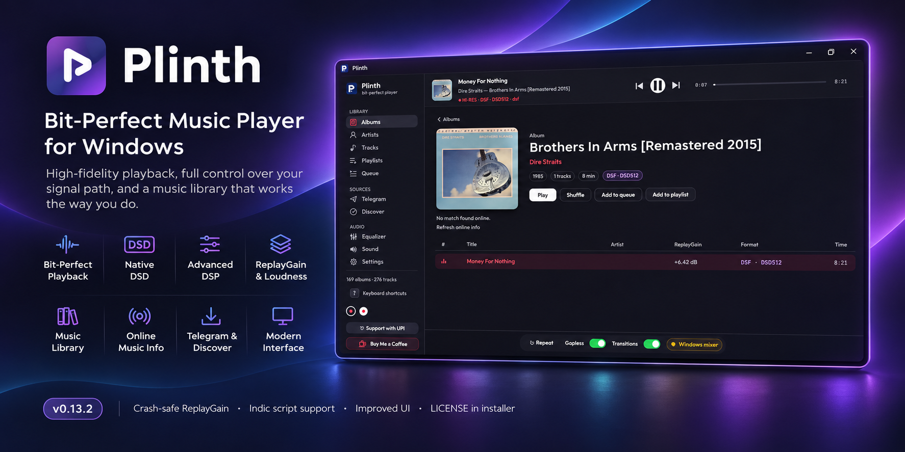

  

# Plinth — Bit-Perfect Music Player for Windows

**Plinth** is a high-fidelity desktop music player for Windows, designed for listeners who care about sound quality, playback accuracy, and control over their audio signal path.

---

## ✨ Features at a Glance

- 🎧 **Bit-Perfect Playback** — WASAPI Exclusive, ASIO and WASAPI Shared output.
- 🔊 **Native DSD** — DoP output from DSD64 to DSD512.
- 🎚️ **Advanced DSP** — Upsampling, parametric EQ, crossfeed and room correction.
- 📀 **Extensive Format Support** — FLAC, WAV, DSD, ALAC, AIFF, MP3, Opus and more.
- 📚 **Music Library** — Automatic scanning, metadata, artwork, playlists and search.
- 🎵 **Gapless Playback** — Seamless transitions, including across sample-rate changes when the stream can remain open.
- 🎛️ **ReplayGain** — Loudness analysis, tag writing and playback normalisation.
- 🌐 **Online Music Information** — Artist biographies, album details, credits and artwork.
- 📥 **Music Discovery** — Browse and download audio from Telegram and the Internet Archive.
- 🎨 **Premium Interface** — Dark and Light themes, immersive Now Playing and audio visualizers.
- 🔒 **Privacy First** — No analytics, telemetry or background data collection.

---

## 📥 Download Plinth

**Experience bit-perfect music playback on Windows.**

<kbd>Latest Stable Release: v0.13.2</kbd>

  

### Latest Release — v0.13.2

- Crash-safe ReplayGain tag writing.
- Fixed Hindi and Indic script rendering.
- Improved interface text and usability.
- LICENSE file included in installer.

**Installation**

1. Download the latest Windows installer.
2. Run the `.exe` file.
3. Follow the installation instructions.
4. Launch Plinth and enjoy your music.

**System:** Windows

**Release history:** [View all Plinth releases](https://github.com/gunjanpratap/plinthplayer-releases/releases)

**Checksums:** SHA-256 verification is provided for installer integrity.

---

# 🎧 Playback & Audio Output

Plinth gives you explicit control over how audio reaches your DAC.

- **WASAPI Exclusive:** Bit-perfect playback. With all processing disabled, samples are only bit-shifted into the DAC's output container (16, 24, 24-in-32 or 32-bit). Audio samples are never altered.
- **WASAPI Shared:** Audio passes through the Windows audio mixer.
- **ASIO:** Discovers installed ASIO drivers and allows direct driver selection. ASIO never silently falls back to another output mode.
- **No Silent Fallbacks:** Plinth never switches output modes behind your back. If a device or format is rejected, playback stops and explains why.
- **Extensive Format Support:**
  - FLAC, WAV, AIFF, ALAC and AAC (M4A)
  - MP3, Ogg Vorbis and Opus
  - APE, WavPack and WMA/ASF (through Windows Media Foundation)
  - DSF and DFF, including DST-compressed DFF

### Gapless Playback & Transitions

- Gapless playback whenever consecutive tracks can share the same live output stream, including sample-rate changes.
- When reopening the output is necessary, Plinth explicitly reports the transition instead of describing it as gapless.
- Dedicated Gapless On/Off switch in the player bar.
- Optional song transitions (disabled by default):
  - **Crossfade:** Equal-power crossfading.
  - **AutoMix:** Silence trimming, beat-aware overlap, pitch-preserving tempo matching when track tempos are compatible, and smooth fade fallback.
- Configure overlap length and fallback duration in Settings.
- Native DSD, unknown durations, resampling and mismatched formats use a normal handoff.

### Playback Controls

- Repeat modes: Off, All and One.
- Previous/Next track navigation.
- CUE sheet support:
  - External `.cue` files.
  - Embedded FLAC CUESHEET tracks.
  - Individual queue entries and file-relative seeking.
- Per-device output and DSP profiles, remembered for each DAC.
- Adjustable audio buffer size for slow disks and network drives.

### First-Play Volume Protection

Before the first playback, Plinth requests volume confirmation and displays any positive ReplayGain or EQ boost.

**Note:** Plinth cannot read or control the hardware volume of your DAC or amplifier.

---

# 🔊 DSD Playback

Plinth supports native DSD playback with automatic handling of DAC capabilities.

- Native DSD output through DoP (DSD over PCM).
- Bit-exact DSD payload, markers and idle pattern.
- Supports DSD64 through DSD512.
- Automatic conversion to 176.4 or 192 kHz PCM when the DAC refuses DoP or DSP processing is enabled.
- Reads ID3 metadata embedded in DSF/DFF files.

---

# 🎚️ Advanced Sound Processing

All processing modules are bypassed when disabled.

### Upsampling
- 2x, 4x, 8x or maximum rate supported by the DAC.
- Stays within the same sample-rate family.
- Kaiser-sinc polyphase resampling.

### Crossfeed
- Headphone crossfeed for a more natural listening experience.

### Room Correction
- Partitioned FFT convolution.
- Supports WAV and FLAC impulse responses.
- Compatible with impulse responses generated by REW, Dirac and similar tools.

### Parametric Equalizer
- Interactive EQ graph with draggable control points.
- Exact frequency, gain and Q-value entry.
- Peak and shelf filter bands.
- AutoEq and REW import.
- Adjustable preamp.

### Additional Processing
- Optional software volume control.
- TPDF dithering.
- Clipping counter.

### Processing Order

Plinth follows a defined processing chain:

`Crossfeed → Room Correction → Upsampling → EQ & Volume → Dither`

### Signal Path Visualization

Click the quality indicator or press **S** to inspect the complete audio signal path.

The panel displays:

- Source
- Processing
- Output
- Audio format between each stage
- Individual stage status colours
- Overall signal-path verdict

Status labels include:

`Bit-perfect | Native DSD | DSP active | Reduced | Windows mixer`

---

# 🎛️ ReplayGain

Plinth includes integrated ReplayGain scanning, tag writing and playback normalization.

### Playback
- Reads track gain, album gain and peak tags.
- Disabled by default.
- Track and Album playback modes.
- Optional clipping protection.

### Library Scanner
- Finds files with missing ReplayGain metadata.
- Analyses loudness.
- Writes standard track gain and peak tags.
- Option to overwrite existing tags.
- **Crash-safe tag writing:** Tags are written to a temporary copy first (introduced in v0.13.2).

### Library Integration
ReplayGain status is displayed in a dedicated library column, with states for:

- Measured
- Missing
- Unsupported
- Error

**Limitation:** WMA/ASF ReplayGain tags are not read or written.

---

# 📚 Music Library

Organize and browse your local music collection with an integrated library manager.

### Library Features
- Folder scanning with metadata, cover art and CUE support.
- Dedicated views for:
  - Albums
  - Artists
  - Tracks
  - Queue
  - Playlists
  - Search
- Debounced automatic rescanning of watched folders.
- Missing files are skipped and reported.

### Browsing & Organization
- Tile and List layouts across every library page.
- Layout preferences remembered between sessions.
- Sortable track columns.
- Genre and Date Added sorting.
- Format-coloured labels.
- Explicit audio resolution display (e.g. `FLAC · 24-bit · 96 kHz`).
- Artist tiles with cached artist photos.
- Local album artwork used as a fallback.

---

# 🎵 Playlists

Create and manage playlists from multiple locations within Plinth.

### Creating Playlists
- From the Playlists page.
- From the Queue using Save as Playlist.
- Directly from an album.
- From any track's context menu.

### Playlist Management
- Mosaic cover artwork.
- Play and Shuffle.
- Add tracks to Queue.
- Rename and Duplicate.
- Delete with confirmation.
- Reorder and remove individual tracks.
- Import and export standard M3U8 playlists.

Playlists store file paths, are saved atomically and survive library rescans.

---

# 🎨 Now Playing

A dedicated listening experience with detailed metadata and immersive artwork.

### Compact View
- Album artwork.
- Track title and artist.
- Audio resolution and codec.
- File details.

### Full View
- Immersive artwork-tinted background.
- Complete metadata display, including available file tags.

### Audio Visualizer
- Real-time spectrum visualization.
- Loudness visualization.
- Bass beat visualization.
- Full-screen visualizer.

The visualizer operates on a copy of the audio samples and never modifies the signal sent to the DAC.

**Note:** The visualizer is disabled during native DSD playback.

---

# 🌐 Online Music Information

Optional online metadata enrichment (disabled by default).

### Artist Information
- Artist photographs.
- Biography and origin.
- Genres and external links.
- Discography.
- Albums you own are clearly identified.

### Album Information
- Album descriptions.
- Record label and catalogue number.
- Release date and genres.
- External links.
- Album and track credits.
- Artwork retrieval for albums without cover art.

### Data Sources
- MusicBrainz
- Wikipedia
- Wikidata
- Cover Art Archive

### Privacy & Caching
- Only artist and album names are transmitted.
- Results are cached locally.
- No changes are made to your music files.
- Background fetching for the entire library.
- Pause and Resume support.
- Optional contact address in the User-Agent.

---

# 📥 Music Sources: Telegram & Discover

Plinth extends beyond your local library with two integrated music discovery sources.

## Telegram

Connect using your own Telegram account and personal API ID and API Hash.

Features include:

- Search Telegram channels or enter an `@username`.
- Browse channel audio files.
- Channel profile pictures.
- Per-channel song search with suggestions.
- Multi-select tracks.
- Download Selected and Download All.
- Remove All Downloads or individual downloads.
- Choose your download folder.
- Sign out and Forget to delete login information and stored credentials.

## Discover — Internet Archive

Explore music from the Internet Archive without creating an account.

Available collections:

- Live Music Archive
- Netlabels
- Community Audio
- Everything

Features include:

- Browse and search available audio.
- View uploader-provided licence information.
- Cover artwork.
- Multi-select downloads.

### Download Management

- Downloads fetch only the exact tracks you select.
- Files are initially written as `.part` and renamed after successful completion.
- Cached files play through Plinth's normal bit-perfect playback engine.
- Default cache limit: **4 GB**.
- Least recently played files are removed when cache space is needed.
- Queue and playlist items are never removed by cache cleanup.

**Important:** Plinth does not suggest, index or rank Telegram channels, nor does it verify licences. Users are responsible for ensuring they have the rights to access and use downloaded content.

---

# 🔄 Application Updates

Plinth includes an integrated application update manager.

Navigate to **Settings → Application Updates** to:

- View installed and latest available versions.
- Read release notes.
- Enable automatic update checks (daily or weekly).
- Download updates manually.
- Install and restart.

### Update Security
- Stable releases only.
- HTTPS-only communication.
- Installer size verification.
- SHA-256 checksum verification against the published checksum.
- No downloading or installation without explicit user interaction.

---

# 🖥️ Interface & Experience

Designed to feel clean, responsive and consistent across Windows systems.

### Themes & Typography
- Dark and Light themes.
- Switch themes using `Ctrl + T`.
- Embedded fonts:
  - Outfit
  - Montserrat
  - JetBrains Mono
- System font fallback for glyphs not covered by bundled fonts, including Japanese, Chinese, Korean, symbols and Indic scripts.

### UI Details
- Smooth hover and focus transitions.
- Slim overlay scrollbars.
- Sidebar scrolling on shorter windows.
- Independent layout preferences for each library page.

### Support Plinth
Support options are available directly in the sidebar:

- Buy Me a Coffee.
- UPI QR code for supporters in India.

---

# ⌨️ Keyboard Shortcuts

Press **`?`** or **`F1`** inside Plinth to view the complete shortcut reference.

| Shortcut | Action |
|---|---|
| `Space` | Play / Pause |
| `← / →` | Seek 5 seconds |
| `Shift + ← / →` | Seek 30 seconds |
| `Ctrl + ← / →` | Previous / Next track |
| `R` | Toggle Repeat |
| `Ctrl + ↑ / ↓` | Software volume |
| `/` or `Ctrl + K` | Search |
| `Ctrl + 1–8` | Navigate between pages |
| `Ctrl + N` | Create new playlist |
| `Ctrl + ,` | Open Settings |
| `Ctrl + E` | Open Now Playing |
| `Page Up / Down` | Scroll |
| `S` | Open Signal Path |

### Now Playing Shortcuts

| Shortcut | Action |
|---|---|
| `F` | Full-screen Now Playing |
| `V` | Toggle Visualizer |
| `M` | Full-screen Visualizer |
| `Esc` | Close the open panel |

---

# 🔒 Privacy

**Plinth has no analytics or telemetry.**

It only communicates with services required for features you choose to use.

| Service | Purpose |
|---|---|
| `api.github.com` and `github.com` | Application update checks and downloads |
| `archive.org` | Discover music browsing and downloads |
| Telegram | Direct communication from your PC |
| MusicBrainz | Artist and album metadata |
| Wikipedia / Wikidata | Artist and album information |
| Cover Art Archive | Album artwork |

Online information retrieval is optional and disabled by default.

Your personal data remains local:

- Music library
- Playlists
- Application settings

Application data is stored in:

`%APPDATA%\Plinth`

---

# ⚠️ Known Limitations

- No streaming-service integration, remote control or multi-room playback.
- Kernel Streaming output is not available (removed in v0.13.0). Plinth supports WASAPI Shared, WASAPI Exclusive and ASIO.
- ReplayGain tags cannot be written for WMA/ASF.
- Room-correction convolution supports mono and stereo only.
- APE decoding supports mono and stereo.
- DST-compressed DFF supports up to 6 channels.
- Floating-point WavPack is not supported.
- Files cannot be played while they are still downloading.
- Downloaded remote tracks cannot currently be added to playlists.
- Arabic and Hebrew text is displayed without text shaping.

## 🎼 Built for the Love of Music

Plinth is built around a simple philosophy:

**Your music. Your DAC. Your signal path. No unwanted processing.**

A desktop music player for listeners who want to know exactly what happens between pressing Play and hearing the music.

